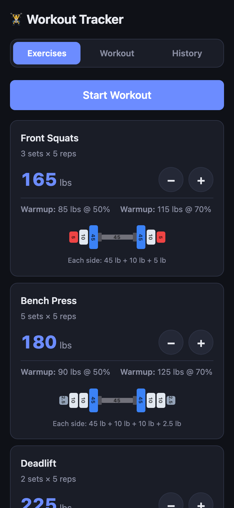
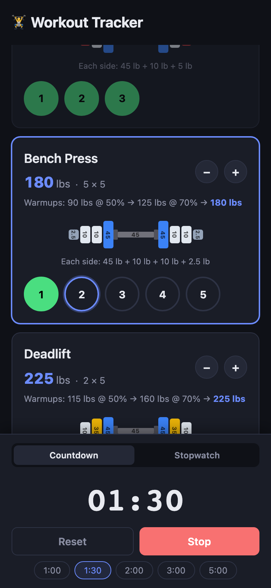
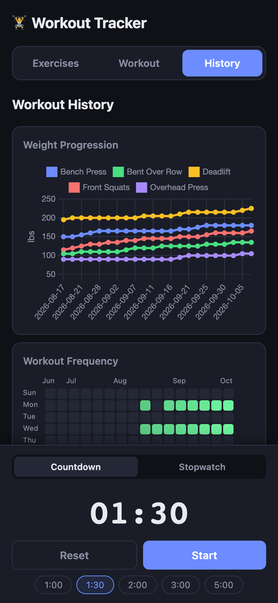

# Workout Tracker

A self-hosted PWA for tracking weightlifting workouts. Built for compound lifts with plate loading visualization, warmup calculations, and rest timers.

| Exercises | Workout | History |
|:---:|:---:|:---:|
|  |  |  |

<sub>Screenshots use sample data.</sub>

## Features

- **Exercise tracking** — Log sets/reps/weight for each exercise with automatic progression (±5 lb increments)
- **Plate calculator** — Visual barbell plate loading guide with color-coded plates
- **Warmup sets** — Auto-calculated warmup weights at configurable percentages
- **Rest timer** — Countdown presets (1:00–5:00) and stopwatch mode with audio/vibration alerts
- **Workout history** — Full logs with date, duration, and exercises completed

## Tech Stack

- **Backend:** Python / Flask
- **Frontend:** Vanilla JS, HTML, CSS (dark theme)
- **Storage:** JSON file (no database required)
- **Deployment:** Docker

## Quick Start

```bash
docker compose up -d
```

Pulls the prebuilt image from `ghcr.io/looselycoupled/workout-webapp` (amd64 and arm64, rebuilt on every push to `main`). App runs at `http://localhost:8080`. Data persists in `./data` via a bind mount.

### Manual

```bash
pip install -r requirements.txt
python app.py
```

Runs at `http://localhost:5000` in debug mode.

## API

| Method | Endpoint | Description |
|--------|----------|-------------|
| GET | `/api/data` | Fetch all data |
| POST | `/api/exercise` | Add exercise |
| DELETE | `/api/exercise/<name>` | Remove exercise |
| POST | `/api/exercise/<name>/increment` | Increase weight |
| POST | `/api/exercise/<name>/decrement` | Decrease weight |
| PUT | `/api/exercise/<name>/weight` | Set specific weight |
| POST | `/api/workout` | Log completed workout |
| GET | `/api/history` | Fetch workout history |
